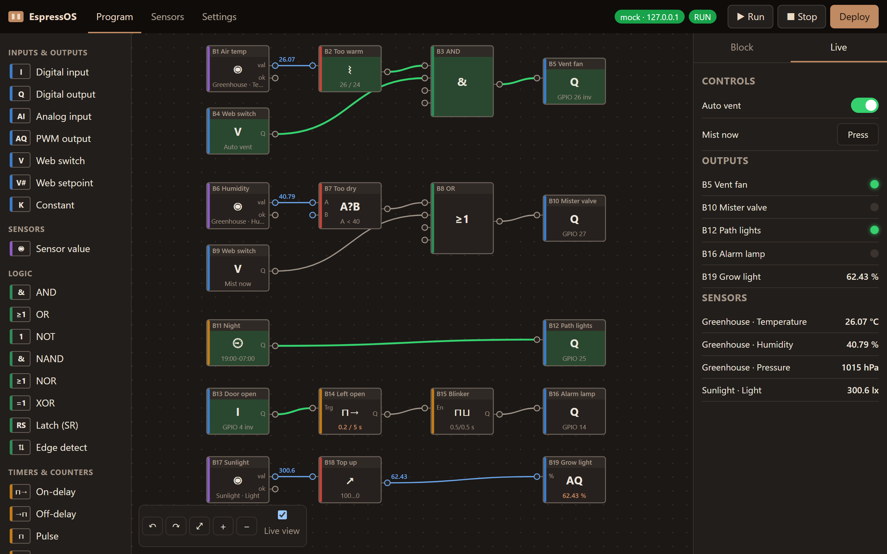
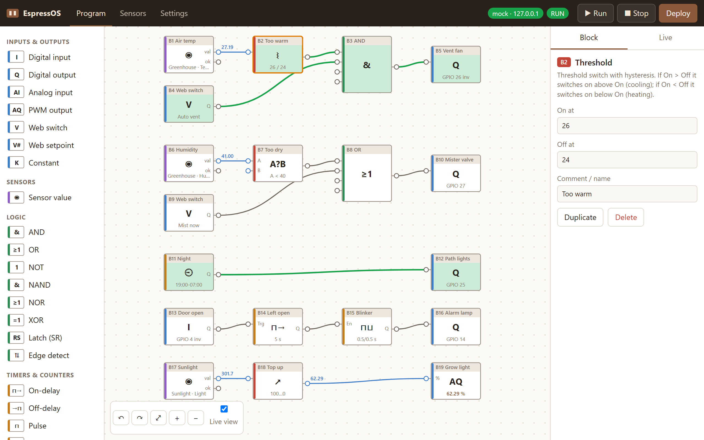
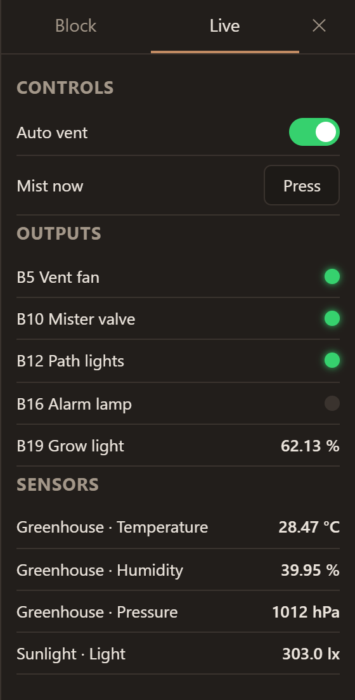
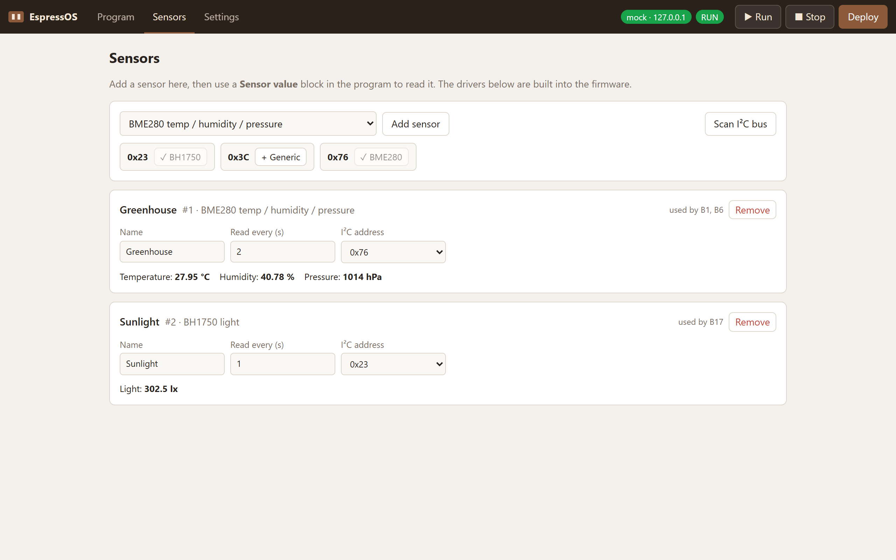

# EspressOS

**Turn a $5 ESP32 into a little PLC you program by drag and drop, straight from your browser.**

Remember Siemens LOGO!? You drop AND gates, timers and counters on a sheet, draw wires, press a button, and your relays start doing things. EspressOS brings that to the ESP32. Flash it once over USB and the board serves its own editor over Wi-Fi. There's nothing to install, no Arduino IDE, and no compile-and-upload loop. Open `http://espressos.local`, wire up your logic, press **Deploy**, and watch it run live.



<sub>A greenhouse controller running live: temperature opens the vent, low humidity opens the mister, a night timer runs the path lights, and the grow light dims as sunlight increases.</sub>

## Why you'll like it

- **Programs in minutes, not compile cycles.** Changes take effect the moment you press Deploy. A bad program is rejected and the old one keeps running.
- **See your logic think.** Wires glow green when high, analog values ride along the wires, and timers count down inside their blocks, just like LOGO!'s online test.
- **Sensors without code.** Scan the I²C bus, click the BME280 it found, and drop a *Sensor value* block. Temperature, humidity, pressure, light, voltage and 1-Wire temperature work out of the box. A *generic I²C register* reader covers many other chips.
- **A control panel for free.** Add web switches, push buttons and setpoints to your program, and they show up as controls on the Live panel, from any phone on your network.
- **Try it before you solder.** With no board connected, the same engine runs as a simulator in your browser. Click inputs to toggle them and watch the outputs respond.
- **Built like a controller, not a toy.** Fixed 10 ms scan cycle on its own CPU core, outputs released to a safe state on stop or redeploy, a watchdog, and the program kept in flash across power cycles.
- **Speaks IEC 61131-3.** Export to PLCopen XML for OpenPLC, Beremiz and other IEC tools, and import their FBD programs.
- **Updates over the air.** New firmware or web UI uploads from the Settings page.

<table>
<tr>
<td width="68%"></td>
<td width="32%"></td>
</tr>
<tr>
<td><sub>Click any block to tune it: thresholds, delays, pins, names. Light and dark themes follow your system.</sub></td>
<td><sub>The Live panel: switches, buttons, output lamps and sensor values.</sub></td>
</tr>
</table>

## The block library

| Category | Blocks |
|---|---|
| **Inputs & outputs** | Digital input, digital output (with active-low option), analog input, PWM output, constant, web switch / push button, web setpoint |
| **Logic** | AND, OR, NOT, NAND, NOR, XOR, SR latch, edge detect |
| **Timers & counters** | On-delay, off-delay, pulse, blinker, weekly timer (NTP clock), up/down counter |
| **Analog** | Compare, threshold with hysteresis, math (+ − × ÷ min max), scale, select |
| **Sensors** | BME280, SHT3x, BH1750, ADS1115, DS18B20, generic I²C register |



## Get started

**Just curious?** Clone the repo and run the editor against a simulated board, no hardware needed:

```bash
npm run mock
```

Then open http://localhost:8080 and import [`examples/greenhouse.json`](examples/greenhouse.json) (or its PLCopen version [`greenhouse.xml`](examples/greenhouse.xml)) from **Settings → Import**, or open http://localhost:8080/?sim for the in-browser simulator.

**Have an ESP32?** You need [PlatformIO](https://platformio.org/) (`pip install platformio`) and an ESP32 dev board (ESP32-WROOM, 4 MB).

```bash
python tools/build_web.py
```

```bash
cd firmware && pio run -t upload && pio run -t uploadfs
```

1. The board starts a Wi-Fi network called `EspressOS-XXXX`. Join it and the setup page opens (or browse to `192.168.4.1`).
2. **Choose an admin password** (the board accepts no programs until you do), and optionally enter your Wi-Fi details. The board restarts and joins your network.
3. Open `http://espressos.local`, log in as `admin`, and start dragging blocks.

Pin notes: I²C defaults to SDA 21 / SCL 22 (changeable in Settings); while a program uses I²C sensors, those two pins can't also be inputs or outputs. GPIO 0, 1 and 3 (boot and serial) and 6–11 (wired to flash) are never offered. GPIO 34–39 are input-only. Analog inputs use ADC1 pins, since ADC2 is unavailable while Wi-Fi is on. The board itself checks all of this on every deploy, so a program from a file can't slip a bad pin past it.

## How it works

```
Browser ──HTTP/WebSocket──► ESP32
  editor + simulator           ├─ web server: UI from LittleFS (gzipped, ~50 KB)
  (web/)                       ├─ REST API  /api/program, /api/run, /api/stop, /api/vin, /api/i2c/scan, /api/config, /api/ota
                               ├─ WebSocket /ws  live values, 4×/s
                               ├─ engine task (core 1): scan cycle every 10 ms
                               └─ sensor task (core 0): polls sensors, caches values
```

A program is plain JSON: blocks, wires `[fromId, fromPort, toId, toPort]` and sensor devices. You can version it in git or share it like the [greenhouse example](examples/greenhouse.json). On deploy the board validates it and sorts the blocks so each runs after its inputs. Feedback loops are allowed and read the previous cycle's value, as on a PLC.

**Run and Stop behave like a PLC.** Stop releases every output (pins go high-impedance, so active-high and active-low relay boards both drop out). Run restarts the program from a clean state: timers, counters and latches reset, and outputs are set up again at their *off* level, so active-low relays never glitch on.

**Security.** The board drives real outputs, so the web API is locked down:
- An admin password is required before the board accepts any program. It is stored as a salted SHA-256 hash, and changes take effect immediately. After 5 wrong passwords, the address that sent them is locked out for 30 seconds, doubling with every further miss.
- Every request is checked *before* the board touches flash or allocates memory. That includes firmware uploads, which the web server library streams before its own auth middleware runs.
- Writes must carry an `X-EOS` header and a matching `Origin`. A web page from another site can't send that header without a CORS preflight, which the board never approves, so such pages can't switch relays. API calls under a foreign `Host` name are refused, which blocks DNS rebinding.
- Request bodies over 64 KB, or of unknown size (chunked), are refused. Settings that could brick the board, like I²C or 1-Wire on flash pins, are rejected.
- After a power cut, the board keeps retrying your router for 2 minutes before opening its own `EspressOS-XXXX` network, so you can still reach it. It closes that network again once the router is back. Only the very first setup network is open; once an admin password exists, it uses WPA2 with a random key that **Settings** shows you. Note it down.
- Settings and the program are saved atomically, with a backup copy, so a power cut while saving can't corrupt them. If the settings were ever unreadable anyway, the board refuses all logins rather than falling back to the open first-setup mode; erase it over USB to start over.
- Firmware updates accept only a real firmware image or web UI image. Any other file is refused, so picking the wrong `.bin` can't wipe the web interface.

Known limits: HTTP Basic auth over plain HTTP, so use it on a network you trust. The Wi-Fi password is stored readably, because the board needs it to connect. Firmware images aren't signed; ESP32 secure boot and flash encryption are the proper fix for both.

**Adding a sensor driver.** The ESP32 can't compile code itself, so drivers are built into the firmware. To add one, write a small class in `firmware/src/Sensors.cpp`, list it in `DRIVERS` in `web/js/catalog.js`, rebuild, and upload `firmware.bin` from **Settings → Firmware update**. Until then, the generic I²C block handles many simple chips.

## IEC 61131-3 / OpenPLC interoperability

**Settings → Export PLCopen XML** writes your program as a PLCopen TC6 XML (v2.01) file with a Function Block Diagram. OpenPLC Editor, Beremiz and other IEC 61131-3 tools can open it. **Settings → Import** reads such files back, both EspressOS exports and FBD programs made elsewhere.

| EspressOS block | IEC 61131-3 |
|---|---|
| AND / OR / XOR / NOT | `AND` / `OR` / `XOR` / `NOT` |
| NAND / NOR | `AND` / `OR` with a negated output |
| Latch (reset wins / set wins) | `RS` / `SR` |
| Edge detect | `R_TRIG` + `F_TRIG` |
| On-delay / Off-delay / Pulse | `TON` / `TOF` / `TP` |
| Counter | `CTUD` (import also takes `CTU`) |
| Compare / Math / Select | `GT` `GE` `LT` `LE` `EQ` `NE` / `ADD` `SUB` `MUL` `DIV` `MIN` `MAX` / `SEL` |
| Digital in / out | variables at `%IX0.n` / `%QX0.n` |
| Analog in / PWM out | `%IWn` / `%QWn` through `EOS_AI` / `EOS_AO` (0–65535 like OpenPLC) |
| Blinker, Threshold, Scale, Weekly timer | `EOS_BLINK`, `EOS_THRESH`, `EOS_SCALE`, `EOS_WEEK`, written in Structured Text and included in the file |
| Web switch / setpoint, Sensor value | plain variables (`V0_…`, `S_…`) |

Feedback loops are routed through a variable, which gives the same one-cycle delay. GPIO pins, block numbers and sensor settings travel in the file's `addData` section, so an exported program imports back unchanged.

When importing a file from another tool:
- Located variables become I/O blocks. EspressOS assigns GPIO pins itself and lists them for you to check.
- Internal variables become wires, and literals become block settings.
- Variables that are only ever read become web controls.
- Unsupported parts are listed instead of silently dropped: Ladder, ST or SFC bodies, `CTD` semantics, `LD` load inputs, and `ET` elapsed-time outputs.

Limits:
- OpenPLC sets ESP32 pins per board, so after exporting, copy the I/O table the export shows into OpenPLC's board settings.
- Sensors and the weekly timer's clock have no IEC equivalent. They're exported as variables you feed from your PLC (`S_…`, `CLOCK_DOW` / `CLOCK_MINUTE`). Weekly timers stay off until you also set `CLOCK_VALID`, just like EspressOS keeps them off until its clock is synced.
- The PWM frequency of an analog output isn't exported; OpenPLC uses its board's own.
- Inverted digital inputs and outputs are exported as `NOT` blocks, because OpenPLC ignores inversion marks on variables. EspressOS folds them back in when you re-import.

Every push runs the [IEC check](.github/workflows/iec.yml) on GitHub Actions:
1. Export the [examples](examples/) and validate them against the official PLCopen schema.
2. Convert them to Structured Text with OpenPLC Editor's own generator, and compile the result with OpenPLC's `matiec` compiler and `gcc`, exactly as OpenPLC does before uploading to a board.
3. Run the compiled programs for 3,000 scan cycles on random inputs (switches, analog values, sensors, the clock) next to EspressOS's engine, and check that every output matches on every cycle.

## Development

| What | Command |
|---|---|
| Editor against a fake board | `npm run mock`, then open http://localhost:8080 (starts in first-run setup mode; add `-- --configured` to skip it) |
| Pure simulator | open http://localhost:8080/?sim |
| JS engine + PLCopen tests | `npm test` (set `PLCOPEN_XSD` to OpenPLC/Beremiz's `tc6_xml_v201.xsd` and install `lxml` to also validate exports against the schema) |
| C++ engine tests | `cd firmware && pio test -e native` (needs a host g++) |
| Bundle the UI for the board | `npm run build:web` |
| Export programs to PLCopen XML | `node tools/export_plcopen.js <out-dir> examples/*.json` |
| Compile exports with OpenPLC's toolchain and compare behaviour | runs in CI ([`iec.yml`](.github/workflows/iec.yml)); `tools/iec_behaviour.js` builds the test harness |

[`ci.yml`](.github/workflows/ci.yml) runs the JS and C++ tests and builds the firmware and web UI image on every push.

The engine is implemented twice: in C++ for the board (`firmware/lib/engine`) and in JS for the simulator (`web/js/sim.js`). Both run the same test cases, and `tools/test_sim.js` checks that the block tables in `Blocks.cpp`, `sim.js` and `catalog.js` stay in sync.

## Status

EspressOS is young. Two self-reviews found 29 issues across security, controller behaviour, IEC export and the interface, and all have been fixed. Tested on every push:
- C++ engine: 15 tests. JS engine: 18 tests.
- PLCopen import/export: 9 tests, including schema validation and checking that a program behaves the same after export and re-import.
- OpenPLC: the exports compile with `matiec` and behave the same as in EspressOS.
- The firmware build: 1.57 MB of the 1.9 MB app slot.

The complete editor flow is tested by hand against the mock board and the simulator.

**Runs on real hardware.** EspressOS has been flashed to an ESP32 dev board (ESP32-D0WD-V3, CH340 USB). It booted cleanly, went through the setup page, joined the home Wi-Fi and served the editor. A deployed program then switched the on-board LED (GPIO 2) live from a web switch, analog inputs read a joystick's position, and the board stayed cool. Not yet tried on hardware: sensor drivers, PWM outputs, firmware updates over Wi-Fi, and the fallback network after a router outage. Reports from other boards are very welcome.

On the roadmap: Modbus RTU and UART blocks, an MQTT/HTTP output block, CI-built `.bin` releases you can flash from the browser, and retentive (power-fail-safe) counters.

## License

MIT, see [LICENSE](LICENSE).
