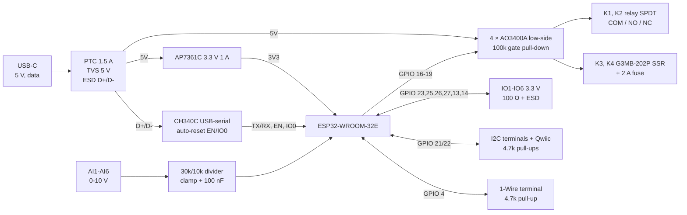

# MB-1: 6 analog in, 2 relays, 2 SSRs (rev A, design)

MB-1 is a DIN-rail carrier board for an ESP32-WROOM-32E module. It is the hardware that the `eos-mb1` board profile in [web/js/boards.js](../../web/js/boards.js) describes. This document is the design: decisions, block diagram, pin map, terminal layout, circuits with values, the KiCad schematic, a BOM and layout rules.

**Status:** schematic done (generated, netlist-checked). There is no PCB layout yet, and nothing has been ordered or built.

## Design decisions

| Topic | Choice | Why |
|---|---|---|
| Power | 5 V from USB-C only | One connector for power and programming; no supply on the board for 12/24 V. |
| Module | ESP32-WROOM-32E-N4 (PCB antenna) | GPIO 16 and 17 are relay outputs, so a WROVER module is ruled out: on WROVER those pins drive the PSRAM. Use the -32UE (external antenna) if the case sits in a metal cabinet. |
| Outputs | R1, R2: mechanical relays with NO and NC contacts. R3, R4: Omron G3MB-202P solid-state relays | Relays switch AC or DC and have a changeover contact. The SSRs switch AC silently and often (heaters, pumps). |
| Analog in | 6 × 0–10 V | The industrial standard; the same terminals also work as 12–24 V digital inputs. |
| Build | JLCPCB SMD assembly; through-hole parts (terminals, relays, SSRs, fuse holders) soldered by hand | |
| Enclosure | 6-module DIN-rail case, for example Camdenboss CNMB/6/KIT | Check the internal PCB size against the case drawing before layout. |

> **Mains warning.** The relay contacts and the SSRs carry mains voltage on this PCB. Wiring and layout have to follow the creepage rules below. The board belongs in a closed enclosure, behind an upstream circuit breaker. Mains work must be done by someone qualified to do it.

## Block diagram



## Pin map (must match the `eos-mb1` profile)

| GPIO | Terminal | Profile uses | Circuit | Notes |
|---|---|---|---|---|
| 36 (SENSOR_VP) | AI1 | ai, di | 0–10 V divider | input only, no internal pull |
| 39 (SENSOR_VN) | AI2 | ai, di | 0–10 V divider | input only |
| 34 | AI3 | ai, di | 0–10 V divider | input only |
| 35 | AI4 | ai, di | 0–10 V divider | input only |
| 32 | AI5 | ai, di | 0–10 V divider | internal pull-up must stay off (`pull: false`) |
| 33 | AI6 | ai, di | 0–10 V divider | same |
| 16 | R1 | do, active high | AO3400A → K1 relay coil | high-Z at reset, so a 100k pull-down keeps it off |
| 17 | R2 | do, active high | AO3400A → K2 relay coil | same |
| 18 | R3 | do, active high | AO3400A → K3 SSR input | same |
| 19 | R4 | do, active high | AO3400A → K4 SSR input | same |
| 23 | IO1 | di, do, pwm | 100 Ω + ESD | 3.3 V logic |
| 25 | IO2 | di, do, pwm | 100 Ω + ESD | |
| 26 | IO3 | di, do, pwm | 100 Ω + ESD | |
| 27 | IO4 | di, do, pwm | 100 Ω + ESD | |
| 13 | IO5 | di, do, pwm | 100 Ω + ESD | |
| 14 | IO6 | di | 100 Ω + ESD | input only in the profile: GPIO 14 outputs PWM during boot |
| 21 | SDA | I2C bus | 4.7k to 3V3, ESD | terminal and Qwiic connector |
| 22 | SCL | I2C bus | 4.7k to 3V3, ESD | |
| 4 | DQ | 1-Wire | 4.7k to 3V3, ESD | DS18B20 |
| 0 | — | BOOT button, auto-reset | 10k pull-up | strapping pin, not a terminal |
| EN | — | RESET button, auto-reset | 10k + 1 µF | |
| 1 / 3 | — | U0TXD / U0RXD → CH340C | | serial console and flashing |
| 2, 5, 12, 15 | — | not connected | | strapping pins; leave them open |
| 6–11 | — | module flash | | never route |

## Terminals

Mains is on the lower edge (5.08 mm pitch, rated 250 V). Safety extra-low voltage (SELV) is on the upper edge (3.5 mm pitch). USB-C is on the upper edge too.

**Upper edge (SELV), left to right**

| Block | Positions |
|---|---|
| USB-C | power and programming |
| Analog (8) | AI1 · AI2 · AI3 · AI4 · AI5 · AI6 · GND · GND |
| GPIO (8) | IO1 · IO2 · IO3 · IO4 · IO5 · IO6 · 3V3 · GND |
| 1-Wire (3) | 3V3 · DQ · GND |
| I2C (4) | 3V3 · SDA · SCL · GND, plus a Qwiic/STEMMA QT socket beside it |

**Lower edge (mains), left to right**

| Block | Positions | Rating on this board |
|---|---|---|
| R1 (3) | COM · NO · NC | 250 V AC / 30 V DC, 5 A (derated from the relay's 10 A for PCB and terminals) |
| R2 (3) | COM · NO · NC | same |
| R3 (2) | L in · Load | 100–240 V AC, 0.1–2 A, AC only; 2 A fuse on board |
| R4 (2) | L in · Load | same |

The 3V3 terminal positions share a 200 mA PTC, so a shorted sensor cable cannot reset the ESP32.

## Circuits

### Power: USB-C 5 V
- J1: USB-C receptacle (USB 2.0, 16-pin). CC1 and CC2 each go to GND through their own 5.1 kΩ (R1, R2). Without those the C-to-C charger gives no power.
- F1: PTC, 1.5 A hold, on VBUS. D1: SMAJ5.0A TVS from VBUS to GND. C1 100 µF/10 V and C2 10 µF on the 5V rail.
- U2: AP7361C-33E (1 A, about 0.36 V dropout) from 5V to 3V3. Input C3 10 µF, output C4 22 µF + C5 100 nF. Do not use AMS1117: its 1.1 V dropout leaves no margin when USB VBUS sags.
- D2 + R3 1 kΩ: green power LED on 3V3.
- **Budget:** ESP32 Wi-Fi peaks at about 500 mA; each relay coil draws about 72 mA; each SSR input about 10–20 mA; LEDs about 10 mA. The total peak is about 0.75 A. Use a USB-C charger or a USB 3 port rated for at least 1 A. A USB 2 port (500 mA) may brown out when Wi-Fi transmits with both relays on.

### USB-serial and auto-reset
- U3: CH340C (internal oscillator), powered from **3V3**: VCC and V3 tied to 3V3, C6 100 nF. At 3.3 V its TXD cannot over-drive the ESP32's RX pin, which is not 5 V tolerant.
- U4: USBLC6-2SC6 on D+/D− at the connector.
- U3 TXD → ESP32 RXD0 (GPIO 3); U3 RXD → ESP32 TXD0 (GPIO 1).
- Auto-reset is the classic two-transistor circuit (Q1, Q2 MMBT3904, R4/R5 10 kΩ bases):
  - DTR → R4 → Q1 base. Q1 emitter goes to RTS and its collector to IO0.
  - RTS → R5 → Q2 base. Q2 emitter goes to DTR and its collector to EN.
- EN: R6 10 kΩ to 3V3 and C7 1 µF to GND (Espressif's RC delay); SW1 RESET to GND.
- IO0: R7 10 kΩ to 3V3; SW2 BOOT to GND. **Both buttons must be reachable through the front of the case:** the node firmware (mesh) uses BOOT at power-up to reopen its setup network.

### ESP32 module
- U1: ESP32-WROOM-32E-N4. 3V3 decoupling at the module: C8 22 µF + C9 100 nF + C10 100 nF.
- The antenna sits at a board edge with no copper on any layer under or next to it (see Espressif's keep-out drawing), as far as possible from the relays and the mains area.

### Outputs R1–R4 (×4, n = 1…4)
Each output is a low-side N-MOSFET with its gate held low, so the output is off while the ESP32 boots (GPIO 16–19 float at reset).

- GPIO → Rg(n) 100 Ω → gate Qn (AO3400A). Rpd(n) 100 kΩ from gate to GND.
- **R1, R2 (relays K1, K2, HF3FF/005-1ZS):** coil between 5V and the drain. Flyback diode D(n) 1N4148W across the coil (cathode to 5V). Indicator LED + 1 kΩ from 5V to the drain.
- **R3, R4 (SSRs K3, K4, G3MB-202P):** input + to 5V, input − to the drain. Indicator LED + 1 kΩ from 5V to the drain. Load side: terminal "L in" → fuse F3/F4 (2 A time-lag, TR5) → SSR terminal; the other SSR terminal goes to terminal "Load". Check the G3MB-202P pin order (input +/−, load pins) against the Omron datasheet when drawing the footprint.
- G3MB-202P notes for the user:
  - It switches AC only; it never turns a DC load off.
  - Its built-in snubber passes a small leakage current, so a very small load such as an LED lamp under about 0.1 A can glow while the output is off. The profile note says 0.1–2 A for that reason.

### Analog inputs AI1–AI6 (×6)
Terminal → Rs 30 kΩ 1 % → node → ESP32 pin; node → Rb 10 kΩ 1 % to GND; node → C 100 nF to GND; node → BAT54S common pin. BAT54S pin 1 goes to GND and pin 2 to 3V3.

- Divider ratio 4: **10 V at the terminal = 2.5 V at the ADC**, inside the ESP32's useful 12 dB range. Full scale is reached at about 13 V.
- Input impedance is 40 kΩ, as 0–10 V sensors expect.
- Protected up to 30 V continuous: the clamp current is (30 − 3.6) / 30k ≈ 0.9 mA per input, well below what the ESP32 draws from 3V3.
- **As digital inputs** (`di`): high above about 10 V and low below about 3.3 V at the terminal. That works for 12 V and 24 V signals, but not for 5 V logic: use an IO terminal for that.
- **Scaling in the editor:** the AI block maps raw 0…4095 to min…max, and "Value at 3.3 V" is 13.2 V at the terminal. For a 0–10 V sensor that should read 0–100 %, set min 0 and max 132. The ESP32 ADC is not linear near both ends, so expect ±2–3 % without calibration (see Follow-ups).

### GPIO IO1–IO6 (×6)
- GPIO ← 100 Ω → terminal; ESD: U5 TPD4E05U06 (IO1–IO4), U6 TPD4E05U06 (IO5, IO6, SDA, SCL).
- These are 3.3 V logic pins, without isolation or level shifting. Inputs must stay within 0–3.3 V. Outputs give at most about 12 mA, enough for an LED, an external relay module input or a MOSFET module.

### I2C and 1-Wire
- SDA (GPIO 21) and SCL (GPIO 22): R 4.7 kΩ each to 3V3. Wired to the I2C terminal and J5 (JST SM04B-SRSS-TB, Qwiic pinout GND · 3V3 · SDA · SCL).
- DQ (GPIO 4): R 4.7 kΩ to 3V3. ESD: D (PESD3V3L1BA).
- F2: PTC 200 mA hold between 3V3 and the "3V3 out" net that feeds every 3V3 terminal position and J5.

## Schematic

[MB-1.kicad_sch](MB-1.kicad_sch) is the schematic (KiCad 8 format; it opens in KiCad 8, 9 and 10), and [MB-1.pdf](MB-1.pdf) is a print of it. Open [MB-1.kicad_pro](MB-1.kicad_pro) in KiCad.

**It is generated.** [gen_schematic.py](gen_schematic.py) holds every part, its value, footprint and part number, and the net on each pin. The script copies the symbols from KiCad's own libraries and draws the sheet:
- six blocks, matching the sections above;
- net labels at the pins and power symbols for GND, +5V and +3V3;
- a no-connect flag on every pin that isn't used.

To change the circuit, edit the script and generate again, rather than editing the sheet by hand:

```bash
python gen_schematic.py
kicad-cli sch erc MB-1.kicad_sch
kicad-cli sch export netlist --format kicadsexpr -o MB-1.net MB-1.kicad_sch
python check_netlist.py MB-1.net
kicad-cli sch export pdf -o MB-1.pdf MB-1.kicad_sch
```

[check_netlist.py](check_netlist.py) compares the netlist KiCad reads from the sheet with the nets in the script, pin by pin. A label that lands on the wrong pin would short or split a net without any ERC error. The current sheet gives 73 nets and 0 differences.

**ERC:** the electrical check has one expected error: "power output connected to power output" between U2 VO and U3 V3. The CH340C datasheet ties V3 to VCC when the chip runs at 3.3 V. Exclude it in KiCad's ERC dialog. On a KiCad install whose library tables were never set up, `kicad-cli` also lists "library not in the current configuration" warnings; those go away once KiCad has been started once.

**Before the PCB:**
- *K3/K4 symbol:* KiCad has no Omron G3MB. The sheet uses the Sharp S202S02 symbol, which does the same job: input 3 (+) and 4 (−), output 1 and 2.
- *K3/K4 footprint:* the footprint is set to `MB-1:Omron_G3MB-202P_SIP4`, a project library that doesn't exist yet. Draw it from Omron's G3MB dimension drawing, and check the pin order there too.
- *F3/F4:* these use TR5 fuse sockets (Littelfuse 560/460 series), so a blown fuse can be swapped.

Reference designators on the sheet:

| Function | Refs |
|---|---|
| Power | J1, R1–R3, F1, D1, C1–C5, LED1, U2 |
| USB-serial, reset | U3, U4, Q1, Q2, R4–R7, C6, C7, SW1 (RESET), SW2 (BOOT) |
| ESP32 | U1, C8–C10 |
| Outputs (n = 1…4) | gate resistor R11–R14, gate pull-down R15–R18, MOSFET Q3–Q6, LED2–LED5 with R19–R22, relays K1/K2 with flyback D4/D5, SSRs K3/K4 with fuses F3/F4, terminals J2–J4 |
| Analog in (n = 1…6) | series R23–R28 (30k), to GND R29–R34 (10k), C11–C16, clamp D6–D11, terminal J6 |
| GPIO, buses | series R35–R40, ESD U5/U6 and D3, I2C pull-ups R8/R9, 1-Wire pull-up R10, PTC F2, terminals J7–J9, Qwiic J5 |

## BOM (one board)

Manufacturer part numbers are real parts. Look up the LCSC numbers in the JLCPCB catalogue when drawing the schematic, and prefer "basic" parts for the passives.

| Ref | Qty | Part | Manufacturer / MPN | Notes |
|---|---|---|---|---|
| U1 | 1 | ESP32 module, 4 MB | Espressif ESP32-WROOM-32E-N4 | -N8 also fits; never WROVER |
| U2 | 1 | LDO 3.3 V 1 A, SOT-223 | Diodes AP7361C-33E-13 | |
| U3 | 1 | USB-serial, SOP-16 | WCH CH340C | powered from 3V3 |
| U4 | 1 | USB ESD, SOT-23-6 | ST USBLC6-2SC6 | |
| U5, U6 | 2 | 4-ch ESD, USON-10 | TI TPD4E05U06DQAR | |
| Q1, Q2 | 2 | NPN, SOT-23 | onsemi MMBT3904 | |
| Q3–Q6 | 4 | N-MOSFET logic level, SOT-23 | AOS AO3400A | |
| K1, K2 | 2 | Relay SPDT 5 V, 10 A | Hongfa HF3FF/005-1ZS | Songle SRD-05VDC-SL-C fits the same footprint |
| K3, K4 | 2 | SSR 2 A AC, zero-cross, SIP-4 | Omron G3MB-202P DC5 | |
| F1 | 1 | PTC 1.5 A hold, 1206/1812 | Bourns MF-MSMF150-2 | |
| F2 | 1 | PTC 0.2 A hold | Bourns MF-MSMF020-2 | |
| F3, F4 | 2 | Fuse 2 A time-lag, TR5, in a TR5 socket | Littelfuse 372 series 2 A T + 560 series socket | |
| D1 | 1 | TVS 5 V, SMA | Littelfuse SMAJ5.0A | |
| D3 | 1 | ESD diode for DQ, SOD-323 | Nexperia PESD3V3L1BA | |
| D4, D5 | 2 | Flyback diodes, SOD-123 | 1N4148W | |
| Dc1–Dc6 | 6 | Schottky pair, SOT-23 | Nexperia BAT54S | |
| LED1–LED5 | 5 | 0603 LED | 1 green (power), 4 red (outputs) | |
| J1 | 1 | USB-C 16-pin receptacle | Korean Hroparts TYPE-C-31-M-12 | |
| J2, J3 | 2 | Screw terminal 3-pos 5.08 mm | Phoenix Contact MKDS 1,5/ 3-5,08 (1715734) | |
| J4 | 1 | Screw terminal 4-pos 5.08 mm | Phoenix Contact MKDS 1,5/ 4-5,08 (1715747) | |
| J6, J7 | 2 | Screw terminal 8-pos 3.5 mm | any 3.5 mm PCB terminal (e.g. Phoenix PT 1,5 series) | |
| J8 / J9 | 1 / 1 | Screw terminal 3-pos / 4-pos 3.5 mm | same series | |
| J5 | 1 | Qwiic socket | JST SM04B-SRSS-TB | |
| SW1, SW2 | 2 | Tact switch, SMD | any 6×6 or 5.1×5.1 mm | reachable from the front |
| R | — | 0603 resistors | 5.1k ×2, 1k ×5, 10k ×4 + 6 (1 %), 30k 1 % ×6, 100R ×10, 100k ×4, 4.7k ×3 | |
| C | — | Capacitors | 100 µF/10 V ×1 (electrolytic or 1206 ceramic), 22 µF ×2, 10 µF ×2, 1 µF ×1, 100 nF ×10 | X5R/X7R, 10 V or more |
| Case | 1 | 6-module DIN-rail enclosure | Camdenboss CNMB/6/KIT | check the PCB outline |

## Layout rules

- **Mains area** (K1–K4 load side, F3/F4, J2–J4) on the lower part of the board.
  - At least **6 mm creepage and clearance** between any mains net and any SELV net.
  - Milled slots under the relays and SSRs between coil/input pins and contact/load pins.
  - At least 3 mm between different mains channels.
  - Load traces at least 3 mm wide on 1 oz copper, or 2 mm on 2 oz, both layers, for 5 A.
  - No ground pour inside the mains area.
- **SELV area:** one solid GND plane. The ESP32, the LDO and the CH340C sit away from the relay coil current loops.
- Antenna keep-out at a board edge that faces the front window of the case, away from the relays.
- Each analog divider sits close to its ESP32 pin, with the 100 nF capacitor right at the pin.
- Silkscreen: terminal labels exactly as the profile names them (AI1…AI6, R1…R4, IO1…IO6), plus "MB-1 rev A".

## Bring-up checklist

1. With no module fitted: power on USB-C and check 5V and 3V3. Measure that DRV1–4 are high (outputs off).
2. Fit the module and flash `pio run -t upload && pio run -t uploadfs` over USB with no button presses. That tests the auto-reset circuit.
3. In the editor, choose Settings → Board → **MB-1** and let it restart. Deploy a program with one DO per output and check that each relay and SSR clicks or switches on its own channel. Power-cycle and confirm that nothing switches during boot.
4. Feed 0, 5 and 10 V to each AI and check the readings (expect raw about 0, 1550 and 3100).
5. Scan I2C with a sensor on the Qwiic socket, and read a DS18B20 on the 1-Wire terminal.

## Follow-ups (not part of rev A)

- **Analog in volts.** Let the firmware read the ADC with `analogReadMilliVolts` (Espressif's calibration), and give a profile terminal an optional scale (here ×4). The AI block would then show terminal volts, so users wouldn't need the "max 132" rule above. That needs a profile schema change in both validators.
- **Power option.** A 24 V version (buck converter to 5 V) for cabinets where USB power is unusual.
